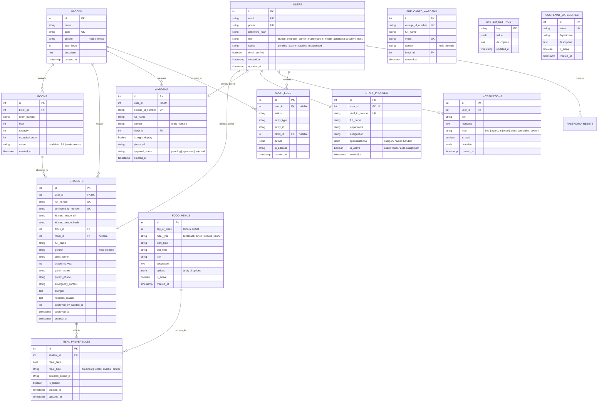

# HostelPulse - Foundation Layer Contracts & Architecture

This document specifies the exact shared contracts, middleware, services, data types, and API conventions for the Hostel Complaint Management System foundation layer. Modules built on top (Complaints/AI, Outpass/Room Allocation, Health) must consume these standards.

---

## 1. Entity-Relationship (ER) Diagram



---

## 2. API Response Envelope

Every endpoint in HostelPulse conforms to this uniform format:

### Success Response
```json
{
  "success": true,
  "data": { ... },
  "error": null
}
```

### Error Response
```json
{
  "success": false,
  "data": null,
  "error": {
    "message": "Human-readable error explanation",
    "code": "ERROR_CODE_STRING",
    "details": [ ... ]
  }
}
```

All foundation routes are prefixed with `/api/v1`.

---

## 3. Shared Middleware Contracts (`/server/src/middleware`)

### 3.1 `authenticate`
Extracts and validates the JWT from `Authorization: Bearer <token>` or cookies.
Attaches the authenticated user payload to `req.user`.

**Export**:
```javascript
const { authenticate } = require('../middleware/auth');
```

**Populated `req.user` Shape**:
```javascript
{
  id: 1,                          // users.id
  email: "student@hostelpulse.edu",
  role: "student",               // student | warden | admin | maintenance | health_assistant | security | mess
  status: "active",
  studentId: 10,                 // Present if role === 'student'
  wardenId: null,                // Present if role === 'warden'
  blockId: 1,                    // Assigned block ID (for student and warden)
  gender: "male",                // Block gender scope
  full_name: "Rahul Sharma"
}
```

### 3.2 `requireRole(...roles)`
Guards endpoints to ensure the caller possesses one of the authorized roles.

**Export**:
```javascript
const { requireRole } = require('../middleware/auth');

// Usage:
router.post('/resolve', authenticate, requireRole('warden', 'admin'), handler);
```

### 3.3 `scopeToBlock`
Enforces hostel block and gender tenancy. Wardens can strictly access data originating from their own block. Admin has bypass privileges across all blocks.

**Export**:
```javascript
const { scopeToBlock } = require('../middleware/scopeToBlock');

// Usage:
router.get('/students', authenticate, scopeToBlock, (req, res) => {
  // req.blockScope is automatically populated:
  // - For warden: req.blockScope = { blockId: req.user.blockId, gender: req.user.gender }
  // - For admin:  req.blockScope = null (unrestricted access)
});
```

---

## 4. Shared Services Contracts (`/server/src/services`)

### 4.1 Notification Service (`notify.js`)
Dispatches cross-channel notifications:
1. Writes record to `notifications` table (immediate in-app delivery).
2. Sends email via Nodemailer (asynchronous, non-blocking).
3. Emits SMS stub to console logs (ready for SMS provider gateway hook).

**Export**:
```javascript
const { notify } = require('../services/notify');

// Usage:
await notify({
  userId: studentUserId,
  title: "Complaint Status Updated",
  message: "Your plumbing complaint #104 has been marked In Progress.",
  type: "complaint", // 'info' | 'approval' | 'food' | 'alert' | 'complaint' | 'system'
  metadata: { complaintId: 104, priority: "high" },
  email: studentEmail,       // Optional: overrides user email lookup
  phone: studentPhone        // Optional: for SMS stub
});
```

### 4.2 Audit Service (`audit.js`)
Records immutable compliance and security audit trails.

**Export**:
```javascript
const { audit } = require('../services/audit');

// Usage:
await audit({
  userId: req.user.id,
  action: "STUDENT_REGISTRATION_APPROVED",
  entityType: "student",
  entityId: studentId,
  blockId: studentBlockId,
  details: { approvedBy: req.user.full_name, timestamp: new Date() },
  ipAddress: req.ip
});
```

---

## 5. Outpass & Mess Contract Export (`/server/src/modules/food`)

To allow the Outpass/Room Allocation module teammate to seamlessly exclude students who have an approved outpass from mess meal calculations, the food service exports:

```javascript
/**
 * Contract Hook for Outpass Module Teammate:
 * Implement or hook your Outpass query in `server/src/services/outpassContract.js`
 * or pass an array of studentIds into `calculateMealReport(date, mealType, options)`.
 */
const { getApprovedOutpassStudentIds } = require('../services/outpassContract');

// Signature:
async function getApprovedOutpassStudentIds(date, mealType) {
  // Returns: Array of student IDs [1, 4, 12] currently on approved outpass
}
```

---

## 6. Secure Uploads Contract

- Student laminated ID photos and sensitive docs are saved outside the public static root in `/server/uploads/ids/`.
- File hashes (SHA-256) are calculated before saving. Re-uploading an identical image causes an immediate rejection to prevent duplicate or fraudulent identities.
- Images are retrieved through authenticated, role-scoped route:
  `GET /api/v1/auth/files/:filename` (Wardens can view photos of students in their block; Admins can view all; Students can view their own).

---

## 7. Maintenance Assignee Auto-Suggestion Contract (`/server/src/services/maintenanceContract.js`)

**FOR TEAMMATE (Complaints & AI Dispatch Module):**
To auto-suggest the optimal maintenance technician based on category (e.g., plumbing vs electrical), use either the Node.js service function or the HTTP endpoint.

### 7.1 Node.js Service Import
```javascript
const { getSuggestedMaintenanceAssignees } = require('../services/maintenanceContract');

// Usage:
// Pass complaint category name, e.g. "Plumbing & Water Supply"
const assignees = await getSuggestedMaintenanceAssignees("Plumbing & Water Supply");
// Returns: Array of active maintenance personnel, sorted with `isBestMatch: true` at top!
```

### 7.2 REST API Endpoint
`GET /api/v1/admin/maintenance/assignees?category=Plumbing+%26+Water+Supply`
**Headers**: `Authorization: Bearer <token>` (Admin role)

**Response Shape**:
```json
{
  "success": true,
  "data": [
    {
      "id": 1,
      "staffIdNumber": "MAINT-101",
      "fullName": "Anil Verma",
      "department": "Facility Maintenance",
      "designation": "Plumbing & Water Specialist",
      "specialisations": ["Plumbing & Water Supply", "Room & Floor Hygiene"],
      "isActive": true,
      "email": "maintenance@hostelpulse.edu",
      "phone": "+919777700001",
      "isBestMatch": true
    }
  ],
  "error": null
}
```

---

## 8. Frontend Complaints Analytics Mount Point Contract

**FOR TEAMMATE (Complaints Analytics / Dashboard Widgets):**
The Admin portal includes a dedicated tab: **"Complaints & AI Analytics"**.
The component is located at:
`client/src/portals/staff/ComplaintsAnalyticsMountPoint.jsx`

Simply drop your widgets, charts, and AI triage summaries into the exported component or replace the shell with your dashboard!

