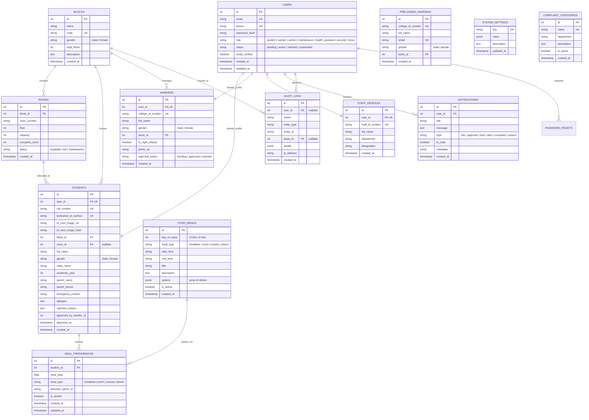

# HostelPulse — Foundation Layer

HostelPulse is a modern Hostel Complaint Management and Administrative System built for university campus residential communities. This repository contains the **FOUNDATION LAYER** upon which subsequent modules (**Complaints/AI Dispatch**, **Outpass/Room Allocation**, and **Resident Healthcare**) are constructed.

---

## 🏗️ Architecture & Technology Stack

- **Backend**: Node.js, Express.js (v4.21), RESTful architecture
- **Database**: PostgreSQL with numbered migrations, indexes, foreign keys, and unique constraints (with automatic in-memory PostgreSQL emulation for instant zero-dependency local testing/demo).
- **Authentication**: JWT (Access Token + Refresh Token), bcrypt (salt rounds 10), express-rate-limit.
- **Uploads**: Multer with disk storage outside public directory (`/server/uploads/ids/`), validated MIME types, 5MB limits, and SHA-256 duplicate image detection.
- **Validation**: Zod runtime schema validation.
- **Frontend**: React 18, Vite 5, Vanilla CSS design system (glassmorphism, vibrant dark/light theme, micro-animations, responsive layout).
- **Cross-Channel Communication**: Nodemailer (Email), SMS stub logger, in-app notifications table.

---

## 🗄️ Database Entity-Relationship (ER) Diagram



---

## ⚡ Quickstart & Setup Guide

### 1. Prerequisites
- Node.js >= 18 (Tested on v22)
- (Optional) PostgreSQL on port 5432. If PostgreSQL is not installed or running, the server automatically boots into an in-memory PostgreSQL emulator (`pg-mem`), allowing zero-configuration evaluation and instant testing!

### 2. Installation
From the root repository directory:
```bash
# Install backend dependencies
cd server
npm install

# Install frontend dependencies
cd ../client
npm install
```

### 3. Database Migration & Demo Data Seeding
Run the numbered migrations and load demo blocks, wardens, students, rooms, menus, and staff:
```bash
cd server
npm run migrate
npm run seed
```

### 4. Run Automated Test Suite
Verify all 13 core foundation requirements (authentication, rate limits, block scoping, warden approvals, food preferences, outpass exclusion hook, and audit logs):
```bash
cd server
npm test
```

### 5. Launch Development Servers
Start both the Express API and Vite React client:
```bash
# Terminal 1: Backend Server (Port 5000)
cd server
npm run dev

# Terminal 2: Frontend Client (Port 3000)
cd client
npm run dev
```

Visit the application at: `http://localhost:3000`

---

## 🔑 Demo Account Credentials

**All demo accounts share the password:** `Password@123`

| Role / Persona | Identifier (Laminated ID / College ID / Email) | Block Scope / Designation |
| :--- | :--- | :--- |
| **Admin (Chief Warden)** | `admin@hostelpulse.edu` | Full Campus (Cross-block visibility) |
| **Boys Warden** | `W-MALE-101` (or `warden.boys@hostelpulse.edu`) | Aryabhatta Boys Block A |
| **Girls Warden** | `W-FEMA-201` (or `warden.girls@hostelpulse.edu`) | Gargi Girls Block B |
| **Deputy Boys Warden** | `W-DEPUTY-102` (or `deputy.warden@hostelpulse.edu`) | Aryabhatta Boys Block A (Night/Deputy) |
| **Student (Male, Active)** | `HID-BBA-001` (or `rahul.sharma@hostelpulse.edu`) | Block A, Room 101 |
| **Student (Female, Active)** | `HID-GBB-001` (or `ananya.reddy@hostelpulse.edu`) | Block B, Room 101 |
| **Student (Male, Pending Approval)** | `HID-BBA-005` (or `pranav.nair@hostelpulse.edu`) | Block A (Test Warden Vikram's Approval Queue) |
| **Student (Female, Pending Approval)**| `HID-GBB-005` (or `meera.krishnan@hostelpulse.edu`) | Block B (Test Warden Sunita's Approval Queue) |
| **Central Mess Staff** | `mess@hostelpulse.edu` | Kitchen & Meal Headcounts |
| **Maintenance Staff** | `maintenance@hostelpulse.edu` | Facility Operations |
| **Healthcare Staff** | `health@hostelpulse.edu` | Campus Health Center |
| **Security Staff** | `security@hostelpulse.edu` | Gate & Access Control |

---

## 📡 API Endpoint Reference (`/api/v1`)

All responses adhere to the uniform `{ success, data, error }` contract.

### Authentication & Identity (`/api/v1/auth`)
| Method | Endpoint | Access | Description |
| :--- | :--- | :--- | :--- |
| `GET` | `/auth/blocks` | Public | List blocks (supports `?gender=male/female`) |
| `POST` | `/auth/register/student` | Public | Register student with Multer ID photo upload (SHA-256 duplicate check) |
| `POST` | `/auth/register/warden` | Public | Register warden (auto-approved if pre-loaded) |
| `POST` | `/auth/login` | Public (Rate-limited) | Login with Laminated ID, College ID, or Email |
| `POST` | `/auth/refresh` | Public | Refresh expired JWT access token |
| `POST` | `/auth/forgot-password` | Public | Request 6-digit password reset OTP |
| `POST` | `/auth/reset-password` | Public | Reset password using valid OTP |
| `GET` | `/auth/me` | Authenticated | Retrieve current session profile and assigned wardens |
| `GET` | `/auth/profile` | Authenticated | Retrieve full profile |
| `PUT` | `/auth/profile` | Authenticated | Update contact phone, allergies, emergency contact |
| `GET` | `/auth/files/:filename` | Authenticated | Secure file server for student ID card photos |
| `GET` | `/auth/pending-students` | Warden, Admin | List pending students scoped to warden's block & gender |
| `POST` | `/auth/students/:id/approve` | Warden, Admin | Approve student registration (activates account) |
| `POST` | `/auth/students/:id/reject` | Warden, Admin | Reject student registration with reason |

### Food & Dining (`/api/v1/food`)
| Method | Endpoint | Access | Description |
| :--- | :--- | :--- | :--- |
| `GET` | `/food/menu` | Public / Auth | View 7-day weekly menu with meal timings and dish options |
| `POST` | `/food/menu` | Admin, Mess | Create or update menu entry |
| `GET` | `/food/preferences` | Student | View student's meal selections for date range |
| `POST` | `/food/preferences` | Student | Submit next-day meal preference (enforces cut-off lock) |
| `GET` | `/food/report` | Admin, Mess, Warden | Kitchen headcount report by block and meal (excludes approved outpasses) |
| `GET` | `/food/cutoff` | Authenticated | Get daily cut-off configuration (default 21:00) |
| `PUT` | `/food/cutoff` | Admin, Mess | Update daily cut-off time |

### In-App Notifications (`/api/v1/notifications`)
| Method | Endpoint | Access | Description |
| :--- | :--- | :--- | :--- |
| `GET` | `/notifications` | Authenticated | List user notifications & unread count |
| `PUT` | `/notifications/:id/read` | Authenticated | Mark specific notification as read |
| `PUT` | `/notifications/read-all` | Authenticated | Mark all notifications as read |

### Administration (`/api/v1/admin`)
| Method | Endpoint | Access | Description |
| :--- | :--- | :--- | :--- |
| `GET` | `/admin/stats` | Admin | Dashboard overview metrics & recent audit entries |
| `GET` | `/admin/blocks` | Admin | List all hostel blocks with occupancy counts |
| `POST` | `/admin/blocks` | Admin | Create a new hostel block |
| `GET` | `/admin/rooms` | Admin | List physical rooms |
| `POST` | `/admin/rooms` | Admin | Add room with floor, capacity, and block mapping |
| `GET` | `/admin/wardens` | Admin | List active wardens and pre-loaded roster |
| `POST` | `/admin/wardens/preload` | Admin | Pre-load warden to enable instant sign-up approval |
| `GET` | `/admin/staff` | Admin | List all operational staff |
| `POST` | `/admin/staff` | Admin | Create staff account (maintenance, health, security, mess, admin) |
| `GET` | `/admin/categories` | Admin | List complaint categories seed list |
| `POST` | `/admin/categories` | Admin | Add complaint category |
| `GET` | `/admin/audit-logs` | Admin | Query immutable compliance and audit trail |

---

## 🤝 Teammate Module Contracts

Teammates implementing Complaints/AI or Outpass/Room Allocation should consult **`CONTRACTS.md`** for shared middleware (`authenticate`, `requireRole`, `scopeToBlock`), notification service (`notify()`), audit logging (`audit()`), and the outpass exclusion function (`getApprovedOutpassStudentIds()`).
